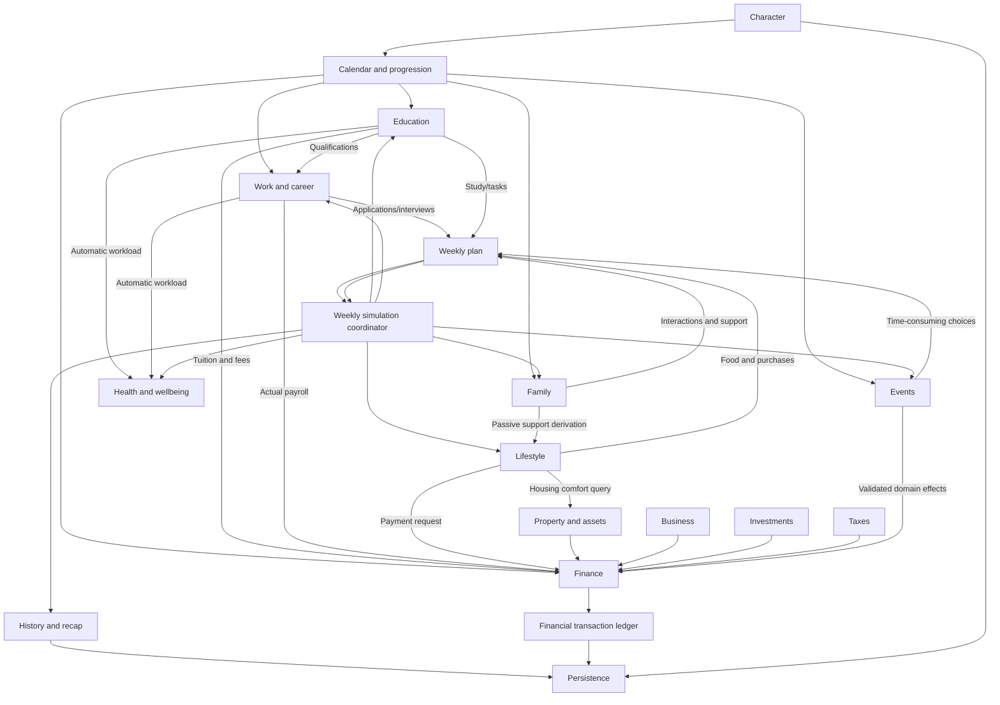

# System Inventory & Dependency Map

**Audit date:** 2026-11-10  
**Audited branch:** `main`  
**Purpose:** Canonical inventory of the systems currently present in the repository, their ownership, maturity, dependencies, cross-system contracts, and known integration gaps.

This document describes the repository as it exists on the audit date. It separates implemented behavior from agreed direction and unfinished work. A screen, type, design note, or exported function is not by itself proof that a complete playable system exists.

## 1. Product and simulation model

My Life Simulator is an Android-first, offline-capable, single-player life simulation. The web application contains the gameplay and pure TypeScript simulation engine; the Android application is a lightweight host for that web experience.

The central time model is:

- **Week:** the primary player turn. The player reviews personal actions, automatic responsibilities, passive support, stamina, costs, and expected consequences, then resolves one week.
- **Month:** the intended future rhythm for payroll, bills, business cash flow, and financial reporting. Monthly settlement is **not yet implemented**.
- **Year:** the current annual financial settlement boundary, birthdays/age progression, annual economic updates, and annual event lifecycle operations.

The calendar is date-based. Age is derived from birth date and current date; the game must not assume that every year is exactly 52 weeks or increment age once per week.

### Core loop

`Character & circumstances → available choices → weekly plan → deterministic weekly resolution → state/history/ledger updates → date progression → annual boundary processing`

The loop is not a player-managed timetable. Education and employment are automatic background responsibilities; the player schedules optional personal actions through the shared weekly plan.

## 2. System inventory

Status labels:
- **Implemented foundation:** real state transitions and playable behavior exist, but the system is not complete.
- **Playable foundation:** the main user-facing loop exists with important depth still missing.
- **Partial / integration-sensitive:** behavior exists, but important contracts or edge cases remain under audit.
- **Planned:** design direction exists; do not expose it as working gameplay.
- **Infrastructure:** supports the game rather than being a player-facing life system.

### 2.1 Character, identity, and creation

**Owner:** `Character` in `web/src/lib/types.ts`; creation in `simulation.ts`; UI in `CharacterCreation.svelte`, `CustomCharacterCreation.svelte`, and `App.svelte`.

**Current behavior**
- Randomized character generation and a custom creation path.
- Character identity, age/birth date, gender, nationality/country, birthplace/language/currency, appearance, attributes, personality/background fields, money, and life-system state.
- Starting age and age-appropriate initial state are supported.
- Character is the shared root aggregate passed through domain operations.

**Dependencies**
- Calendar derives age and life stage from birth date/current date.
- Country/currency settings affect money formatting, prices, and localized values.
- Attributes and age gate Education, Work, Finance, Family, activities, and events.
- All domain systems read Character but should mutate only their owned fields through simulation operations.

**Maturity:** Implemented foundation. Broader life-stage and scenario coverage remains.

### 2.2 Calendar, age, and life-stage progression

**Owner:** `calendar.ts`, `progression.ts`, calendar fields on Character, and the simulation coordinator.

**Current behavior**
- Explicit current date and date helpers.
- Date-derived age and life-stage eligibility.
- Weekly date advancement, birthday boundaries, annual settlement, and annual event expiry.
- Life stages from early childhood through later life.
- Age-based availability for study, work, job applications, career actions, financial products, and other choices.

**Dependencies**
- Character birth date is the source of age.
- Education, Work, Family, Finance, events, and UI availability consume age/stage projections.
- Weekly and annual coordinators own due-boundary execution.

**Maturity:** Implemented foundation. Date-based event deadlines and multi-week advancement remain planned.

### 2.3 Weekly plan, activities, and turn resolution

**Owner:** `weekly-plan.ts` validates the plan; `simulation.ts` owns planning commands, review projection, and `advanceWeek`; UI is in `App.svelte` and each domain workspace.

**Current behavior**
- One persisted weekly plan with stable action IDs and typed action kinds: activity, family, business, event, work, education, care, food, and social.
- Domain screens add or remove actions; the player does not manage a timetable.
- Planning validates eligibility, resources, stamina, and relevant affordability.
- Planned stamina effort is charged during resolution, not when an action is added.
- Weekly resolution applies action outcomes, automatic responsibilities, wellbeing, passive lifestyle effects, history/recap, clothing wear, clears resolved actions, and advances the date.
- A stale/invalid planned action blocks advancement and remains repairable rather than silently disappearing.
- Review aggregates planned effort, costs, stamina recovery, automatic responsibilities, and passive effects.

**Dependencies**
- Reads Character, calendar, age, stamina, money/payment sources, education/work obligations, family/social state, lifestyle purchases, business ownership, and event choices.
- Calls the owning domain operations to resolve each action.
- Writes updated domain state, shared financial transactions, Life History, weekly recap, and calendar.

**Maturity:** Core implemented. The coordinator is integration-critical and currently concentrated in the large `simulation.ts`.

**Important presentation contract:** planned and passive activities belong in one coherent weekly activity review/list. Passive entries are automatic, visually subdued, and non-removable; planned entries are player-selected and removable. A visual distinction must not become two disconnected review experiences. The implementation may retain separate typed collections internally if the review combines them consistently.

### 2.4 Stamina, stress, workload, and wellbeing

**Owner:** `wellbeing.ts`, activity definitions in `progression.ts`, and Character wellbeing fields.

**Current behavior**
- Stamina is the primary personal-action budget.
- Stress and workload affect weekly wellbeing and downstream performance.
- Recovery/care actions include rest, mindfulness, counselling, and medical check-ups.
- Basic health conditions, severity, treatment, medication duration, and high-stress tracking exist.
- Weekly wellbeing resolution adjusts stamina/stress/health and condition progression based on workload and treatment.
- Education and employment responsibilities contribute workload without reserving player-managed calendar slots.

**Dependencies**
- Weekly plan determines selected personal effort.
- Education and Work contribute automatic workload.
- Passive meals/support and purchased food can recover stamina and affect health, happiness, comfort, discipline, or stress.
- Health/workload/stress affect study and work outcomes and can gate event eligibility.
- Family care integration is limited; future caregiving must use explicit contracts.

**Maturity:** Basic playable foundation. Chronic care, insurance, localized healthcare, broader conditions, aging effects, and later-life support remain incomplete.

### 2.5 Education

**Owner:** `education.ts`; UI in `EducationWorkspace.svelte`.

**Current behavior**
- Programme discovery and enrollment.
- Education enrollment, subjects, attendance, weekly study targets, assignments/exams, grades, tuition, academic history, and qualification awards. Education and Educational Records are separate subpages; no Pause Program control is exposed.
- Attendance and progression are automatic background responsibilities.
- Player-selected study/assignment/exam tasks enter the weekly plan and consume stamina.
- Qualifications are persisted and can be consumed by Work eligibility rules.

**Dependencies**
- Character age and eligibility.
- Weekly calendar and automatic workload.
- Stamina, stress, health, and study actions.
- Finance for tuition/fees.
- Work for qualification-based role eligibility.
- History and persistence for academic results and qualifications.

**Maturity:** Playable foundation. Scholarships, retakes, vocational pathways, apprenticeships/internships, licensing depth, and broader localization remain.

### 2.6 Work and career

**Owner:** `work.ts`; career/age rules in `progression.ts`; UI in `WorkWorkspace.svelte`.

**Current behavior**
- Job listings and role eligibility.
- Applications, interviews, rejected/offered/accepted/declined/expired states, expiring offers, employment, resignation, extra earnings, career progression, promotion readiness, and promotion offers.
- Qualification and character-attribute checks influence role eligibility.
- Applications/interviews and selected career actions can be planned as weekly actions.
- Clothing presentation can modestly affect interview first impressions.
- Employment responsibilities contribute automatic workload.
- Annual salary is represented in employment state; annual financial settlement is the current financial cadence.

**Dependencies**
- Character age, attributes, education qualifications, health/workload, clothing presentation, and calendar.
- Weekly plan for player-selected recruitment/career actions.
- Finance for actual income and ledger entries.
- History for applications, offers, employment changes, and promotions.

**Maturity:** Playable foundation. Persistent employers/vacancies, richer workplace decisions, layoffs, benefits, bonuses, and monthly payroll remain planned/incomplete. Salary previews must never create actual ledger income.

### 2.7 Family and social connections

**Owner:** `family.ts` for kinship/guardianship and family bonds; social-circle functions in `lifestyle.ts`; UI in `FamilyWorkspace.svelte` and `LifeTreeWorkspace.svelte`.

**Current behavior**
- Persistent family people, directed kinship/guardianship relationships, player-relative bonds, household-member references, dependency references, family history, and graph validation.
- Generated family-of-origin context; generation must not invent a partner or children.
- Targeted interactions include spending time, reaching out, reconciliation, and financial support.
- Family interactions are weekly actions and use stamina where applicable.
- Adult family support writes to Finance through the shared ledger.
- Explicit social-circle records cover friends, partners, children, and extended family; closeness/support level and co-residence flags influence passive support derivation.
- Family and social records are not interchangeable: a social-circle entry is not proof of kinship, parenthood, guardianship, or household membership.

**Dependencies**
- Character identity and age.
- Calendar-derived relative ages.
- Weekly plan and stamina.
- Lifestyle derives passive support from family/social state and household context.
- Finance records actual support payments.
- History records family changes and interactions.

**Maturity:** Foundation with initial interactions. Partnership lifecycle, separation, parenthood, adoption, dependants, caregiving, family events, future mortality, inheritance, and legacy are not complete.

### 2.8 Lifestyle: Discover, My services, Home, and owned goods

**Owner:** `lifestyle.ts` for simulation behavior; UI in `LifestyleWorkspace.svelte`; household cost settings reuse `FinanceLivingCosts.svelte`.

**Current behavior**
- Lifestyle is a modular Life workspace, not a separate duplicate economy.
- Supermarket supports food, clothing, durable goods and device purchases; Subscriptions owns provider setup and recurring service management.
- Supermarket food is purchased into Owned inventory. The player reserves portions from Owned for the weekly review; reserved portions are consumed at week resolution. Food bonuses are independently capped by stat, and unplanned stock grants no effects.
- Permanent/usable goods and food stock are added to Owned inventory. Active subscriptions provide small service-specific weekly effects; mobile service is required for connected smartphone use and broadband for connected laptop/PC use.
- Clothing has condition/wear and can be equipped; presentation can influence interview outcomes.
- My services reads existing recurring-payment/card/transaction data; it must not create a second subscription ledger.
- Home owns household arrangement and living-cost projections/settings, while actual payment execution remains Finance-owned.
- Passive lifestyle activities are derived from household/family culture, explicitly recorded social connections, residence, and meal availability. They can provide automatic meals/support, comfort, discipline, health, happiness, stress, and stamina effects.
- Passive effects are computed from current state rather than stored as duplicate inventory or relationship facts.

**Dependencies**
- Finance owns payment execution, balances, cards, recurring-payment records, and ledger.
- Family/social records and household arrangement feed passive support.
- Property/rental residence feeds housing comfort.
- Weekly plan resolves food and other planned purchases/actions.
- Health/wellbeing receives food/passive effects.
- Work consumes clothing presentation through a narrow query.

**Maturity:** Implemented foundation, with recent expansion. The older `LIFESTYLE_ECONOMY.md` still labels itself “implementation planned”; that status is stale and must be reconciled with the live implementation and this inventory. Its richer nutrition/economic design remains a specification, not proof that all those mechanics exist.

### 2.9 Finance and banking

**Owner:** finance operations currently reside primarily in `simulation.ts`; UI in `FinanceWorkspace.svelte`, `FinanceAccounts.svelte`, `FinanceProducts.svelte`, and `FinanceTaxes.svelte`.

**Current behavior**
- Cash, bank accounts (checking, savings, fixed deposits), deposits, withdrawals, transfers, and interest.
- Cards (debit, credit, prepaid), card issue/load/purchase/payment, credit limits, interest, and rewards.
- Loans (personal, mortgage, business), applications/issuance, repayment, interest, credit-score/rate/eligibility rules, and rejection scoring.
- Savings goals, automatic deposits, and personal vault deposits/withdrawals.
- Recurring payments for subscriptions/bills, including configured payment source.
- Credit score/profile projections and expandable credit breakdown in Loans.
- Shared financial transaction ledger and financial reporting projections.
- Financial operations validate affordability and must preserve non-negative cash/valid balances; failed operations should leave all state unchanged.

**Dependencies**
- Work payroll and other income sources.
- Family financial support.
- Lifestyle purchases and recurring services.
- Property/mortgages/rent, business, investments, and taxes.
- Events and delayed consequences.
- Annual settlement for current interest/recurring-payment/tax and other due financial behavior.

**Maturity:** Broad foundation. Monthly settlement is not implemented; current annual cadence must not be described as monthly.

### 2.10 Property, investments, business, and economy

**Owner:** Finance domain operations in `simulation.ts`; UI in `FinanceAssets.svelte`; Finance navigation groups Business, Property, Investments.

**Current behavior**
- Property purchase/sale, mortgage association, owned residence selection, rental-home state, property rental income, maintenance, and property valuation.
- Investment holdings and buy/sell operations for stocks/index, technology, energy, government bonds, and gold; market prices and annual economic conditions.
- Business start/manage/close with invested capital, valuation, performance, and annual business results.
- Economic indicators include inflation, growth, base interest rate, economic cycle, and cost-of-living index.
- Tax and net-worth calculations consume relevant asset/income/liability data.

**Dependencies**
- Banking/loans for funding and mortgages.
- Shared Finance ledger for every cash flow.
- Annual settlement/economic updates for valuations, interest, rental/business results, and tax.
- Lifestyle Home and passive housing comfort consume the current residence/household state.
- Work and Family may influence future business/care choices, but those deeper links are not complete.

**Maturity:** Broad foundation. Deeper product variety, monthly cash flow, variable-rate debt, and additional economy simulation remain. Government-bond coupon basis is a confirmed audit item: fixed-rate coupons should be based on face/par value, not fluctuating market price.

### 2.11 Taxes and financial reporting

**Owner:** `FinanceTaxes.svelte` for presentation; annual tax/settlement calculations in `simulation.ts`; `financialTransactions` is the money-movement source.

**Current behavior**
- Tax estimates/assessments and liabilities.
- Annual settlement includes tax-related financial consequences.
- Overview weekly income/expense projections and finance activity views consume the transaction ledger.
- Transfers between the player's own accounts are excluded from income/expense totals.
- Financial activity and Life History are separate projections.

**Dependencies**
- Employment and other income.
- Business results, investment/property activity, interest, and economic conditions.
- Finance ledger, liabilities, balances, and assets.
- Annual boundary processing.

**Maturity:** Implemented foundation, but exact tax coverage and reporting semantics need broader integrated tests. Monthly statements/settlement remain planned.

### 2.12 Events, decisions, and delayed consequences

**Owner:** `events.ts`; coordinator in `simulation.ts`; UI in Overview.

**Current behavior**
- Small authored event catalogue with age/health/circumstance eligibility.
- Stable deterministic event selection based on character/context rather than ambient random selection.
- Pending events and choices persist in Character.
- Choices validate requirements and costs and can apply immediate bounded effects.
- Delayed consequences are persisted and resolved at the annual boundary.
- Event choices can be planned as weekly actions when they consume time/stamina.
- Financial event costs/rewards write to the shared ledger; decision/history records are also created.
- Pending events expire through the annual event lifecycle.

**Dependencies**
- Character attributes, age, health, family context, calendar, weekly plan, and Finance.
- Domain-owned operations for effects; event logic must not reimplement Education/Work/Family/Finance rules.
- History and persistence for pending choices and scheduled consequences.

**Maturity:** Initial system. Sparse event cadence is intentional. Date-based deadlines, cooldowns, richer content/follow-up chains, and deeper cross-domain consequences remain.

### 2.13 History, milestones, recap, and reporting

**Owner:** Character history and financial ledger; projections/grouping in `App.svelte`; family/education/work domains add their own meaningful history records.

**Current behavior**
- Chronological Life History for activity, milestone, and event narratives.
- Weekly recap from resolved turn outcomes.
- Overview activity history grouped by week, with current week expanded by default.
- Life story/history groups milestones and financial records by age/year.
- Family history and academic/career history provide domain-specific context.
- Financial ledger records exact money movements and supports income/expense reporting.
- Settings exposes a compact recent history log.
- History is a projection of domain events, not a second state authority.

**Dependencies**
- Every state-changing domain operation must emit truthful history when appropriate.
- Financial changes must emit ledger records independently of narrative history.
- Calendar provides dates/age/year for grouping.
- Persistence preserves all history and ledger state.

**Maturity:** Implemented foundation. A shared audit is still needed to ensure weekly recap, weekly activity history, life story, domain history, and financial reporting do not omit or duplicate actions.

### 2.14 Life tree and progression visualization

**Owner:** `LifeTreeWorkspace.svelte`; Family owns graph data.

**Current behavior**
- Visualizes family relationships from the Family domain's people/relationship graph.
- It should not own a second graph or infer relationships from social connections.

**Dependencies**
- Family graph and its validated references.
- Character identity and age for context.

**Maturity:** Presentation over the Family foundation; deeper family lifecycle mechanics remain incomplete.

### 2.15 Profile, save slots, settings, and local persistence

**Owner:** `storage.ts`, `App.svelte`, Character/SaveData types.

**Current behavior**
- Three independent save slots.
- Current save schema version 6; debug-export envelope version is separate and must not be conflated with the local schema.
- Strict current-schema validation and explicit reset path for unsupported saves; no backward migrations.
- Theme and sound preferences are app-level settings, not Character state.
- Theme palettes: AMOLED, Midnight, Graphite, Paper.
- Profile/settings expose character information, save management, sound/theme, reload/restart/fullscreen controls, and recent history.
- Debug snapshot export exists for troubleshooting.

**Dependencies**
- Every domain's persisted fields and references.
- Validators must reject malformed state before it becomes an active save.
- Save-slot identity must isolate all Character state.
- Settings must not mutate gameplay saves.

**Maturity:** Infrastructure implemented. The integration audit identifies incomplete recursive nested validation, especially across Finance, Education, Family, Events, and cross-domain references. Do not silently default or migrate invalid current saves.

### 2.16 UI, navigation, themes, and reusable components

**Owner:** Svelte workspaces and shared components; semantic tokens/themes in `web/src/styles/`; global CSS in `app.css`.

**Current behavior**
- Top-level Overview, Education, age-gated Work and Finance, Life, and Profile/Settings navigation.
- Life contains Overview, Lifestyle, Family, Family tree, and Life story.
- Finance contains Banking, Business, Property, Investments, and Taxes; Banking contains Accounts, Cards, Loans, and Savings & vault.
- Reusable buttons, cards, section headers, theme options, and activity-status seals.
- Domain-native workspaces are retained; cross-domain orchestration belongs in simulation contracts.
- AMOLED-first visual system and semantic theme tokens.

**Dependencies**
- Read-only projections and explicit simulation commands.
- UI visibility is a convenience; simulation commands independently enforce age, requirements, and affordability.
- UI must not mutate another domain's state directly.

**Maturity:** Implemented foundation; visual QA and remaining legacy styling cleanup are ongoing.

### 2.17 Android host and release infrastructure

**Owner:** `android/`, `.github/workflows/android.yml`, `.github/workflows/web.yml`.

**Current behavior**
- Android host wraps the web gameplay experience.
- App icon and splash artwork are present.
- Web and Android build/release workflows are defined in GitHub Actions.
- Simulation logic is not Android-specific and should remain portable/offline-capable.

**Dependencies**
- Web build output and static asset paths.
- Android WebView/host bridge for supported app controls.
- CI validates the web simulation and Android packaging separately.

**Maturity:** Infrastructure foundation. Verify current workflow behavior from workflow runs before treating release/deployment as healthy; CI status is not a gameplay-system maturity signal.

### 2.18 Personal technology

**Owner intended:** Future Life inventory domain, with Lifestyle Discover as retail entry and Finance as payment owner.

**Planned direction**
- Individual device instances with stable IDs, category/model/capability tier, condition, acquisition, and ownership/access status.
- Owned, borrowed, shared, school-provided, and work-provided access must be distinct.
- School/Work should query device capability through a narrow API.
- Purchase/repair/resale must atomically update device state and Finance ledger.

**Maturity:** Planned. A design specification exists; do not treat devices as implemented gameplay.

### 2.19 Retirement, mortality, estate, and legacy

**Owner intended:** Global progression/lifecycle system, integrated with Family, Finance, Health, and History.

**Planned direction**
- Retirement and pension progression.
- Terminal life state and prevention of further living-character actions.
- End-of-life summary, estate, inheritance, and legacy.
- Family mortality must be part of the global mortality system, not a separate family-only clock.

**Maturity:** Planned. Later-life age stage exists, but retirement/mortality/estate/legacy are not complete.

## 3. Dependency architecture

### 3.1 Ownership rules

| Fact / state | Single owner | Other systems may |
|---|---|---|
| Player identity, core attributes, birth date | Character | Read and request validated changes |
| Current date, age derivation, life stage | Calendar / progression | Read eligibility projections |
| Education enrollment, grades, qualifications | Education | Work may query qualifications |
| Employment, applications, offers, promotions | Work | Finance may consume actual payroll results |
| Kinship, guardianship, bonds, household/dependency references | Family | Lifestyle may derive support; Finance may record support payments |
| Health conditions, stamina, stress, workload | Health / wellbeing | Other domains submit workload/effects through coordinator |
| Cash, accounts, cards, loans, assets/liabilities, ledger, tax | Finance | Other domains request transactions |
| Supermarket purchases, owned lifestyle goods, clothing condition, service choices | Lifestyle | Finance executes payment; Work reads presentation |
| Residence/property ownership and rental state | Property / Finance assets | Lifestyle derives housing comfort |
| Pending events and scheduled consequences | Events | Domain commands perform actual effects |
| Narrative history and weekly recap | Shared history pipeline / Character history | Domains emit truthful records |
| Save slots and persisted schema | Persistence | Domains provide state validators/contracts |
| Screen state and presentation | UI | Reads projections and dispatches commands |

**Rule:** one owner per fact. Do not duplicate the same balance, relationship, qualification, employment status, subscription, residence, or inventory in another domain.

### 3.2 Primary dependency graph

This graph shows logical ownership/dependency, not a claim that each box is a separate source file. The weekly coordinator currently composes several domains from `simulation.ts`.

### 3.3 Time-boundary responsibilities

| Boundary | Current responsibilities | Not to imply |
|---|---|---|
| Weekly | Planned actions, automatic education/work workload, wellbeing, passive lifestyle effects, food, clothing wear, weekly recap/history, date advance | Monthly payroll or monthly bills |
| Birthday / age boundary | Age and life-stage projection, eligibility changes | A separate NPC clock |
| Annual | Current financial settlement, annual taxes/economic updates, annual event expiry/consequences, annual review | Monthly cash-flow behavior |
| Monthly | Future payroll/bills/business settlement/reporting design | Implemented monthly settlement |

### 3.4 Key integration paths

1. **Character → age → eligibility:** birth date/current date determine age; eligibility is enforced both in UI projections and simulation commands.
2. **Education → Work:** completed qualifications and field/category inform role eligibility. Work must query Education rather than duplicate qualification state.
3. **Education + Work → Wellbeing:** automatic responsibilities create workload; workload/stress/stamina influence learning and performance.
4. **Weekly plan → domain outcomes:** selected actions are validated once and resolved by the coordinator through domain-owned operations.
5. **Family/social → Lifestyle passive support:** family graph, bonds, household membership, social connections, family culture, and residence contribute derived passive activities. These facts must remain separately represented.
6. **Lifestyle → Finance:** market purchases and recurring services use Finance payment paths and the shared ledger; My services reads those same records.
7. **Property → Lifestyle:** owned/rented residence informs household comfort; property cash flows and liabilities remain Finance-owned.
8. **Work → Finance:** employment state is not a bank balance. Only actual settlement writes income to the ledger; offer/salary previews do not.
9. **Events → domains:** event choices validate costs, then call owning-domain effects and record ledger/history/scheduled consequences.
10. **All domains → history + persistence:** narrative history, financial ledger, domain histories, recap, and save state must agree without becoming duplicate sources of truth.

## 4. Cross-system invariants

These are architecture-level correctness requirements, not optional UI details.

1. **Single source of truth:** each persisted fact has one owning domain.
2. **Explicit cross-domain commands:** a Svelte component must not directly mutate a second domain's state.
3. **Atomic financial operations:** balance/asset/liability changes and one corresponding ledger record succeed or fail together.
4. **No hidden money movement:** every charge, reward, payment, support transfer, interest, tax, or fee must be auditable.
5. **No accidental money creation/destruction:** internal transfers preserve total value except explicit recorded fees, interest, taxes, or spending.
6. **Affordability at the simulation boundary:** disabled UI controls are not validation.
7. **Deterministic time:** same state and action sequence produce the same result.
8. **Idempotent period processing:** re-running a resolved week/year must not duplicate outcomes.
9. **Age and prerequisites enforced twice:** UI can hide/disable; simulation must independently reject invalid actions.
10. **Automatic responsibilities are not player actions:** school/work background workload must not be scheduled as optional activities.
11. **History and ledger are distinct:** narrative tells the story; ledger records exact money movement.
12. **No inferred family semantics:** kinship, co-residence, dependency, support, and household arrangement are separate facts.
13. **Passive support is derived, not player-owned action:** it is automatic, non-removable, and must not be charged planned stamina effort.
14. **One weekly review:** planned and passive activities are presented together, with clear status differences.
15. **Persistence validates nested state:** references, IDs, money ranges, dates, action payloads, and cross-field invariants are checked before activation/write.
16. **No silent migrations/default invention:** current schema remains a clean baseline; incompatible changes require an explicit schema update and reset path.
17. **Domain workspaces remain native:** Finance stays Finance, Education stays Education, Work stays Work, etc.; do not replace them with a generic mega-dashboard.

## 5. Confirmed gaps and audit findings

The following are known from the current source/docs audit and should be tracked as integration work, not silently described as completed.

### High priority: correctness and shared state

- **Recursive save validation is incomplete.** `storage.ts` validates the top-level Character shape, selected attributes/calendar fields, weekly plan, and selected pending-event costs, but does not recursively validate all nested Finance, Education, Family, Events, and cross-reference invariants. The Family graph validator is not yet wired into full persistence validation.
- **Weekly action validation needs a complete contract audit.** `weekly-plan.ts` checks supported kinds and selected payloads; verify all numeric ranges, action-specific requirements, duplicate IDs, and cross-domain references before resolution.
- **Simulation orchestration is highly concentrated.** `simulation.ts` owns character generation, weekly coordination, banking, cards, loans, assets, annual settlement, and financial calculations. Extract only stable domain boundaries incrementally; avoid a broad rewrite.
- **Annual settlement order needs explicit coverage.** Income, household costs, auto-deposits, recurring payments, loans, cards, tax, interest, rental income, business results, economic updates, and asset valuation must have a tested order and exactly-once period guard.
- **Government-bond coupon basis:** current annual asset settlement uses units multiplied by current market price for the 4% coupon. Fixed-rate coupon calculation should use face/par value. Add explicit face-value semantics and exact amount/multi-year/ledger tests.
- **History consistency:** ensure the same weekly actions appear accurately in the weekly review, recap, activity history, domain history, and life story, without duplication or omission.
- **Unified activity review:** keep passive and planned activities in one review/list; automatic entries must remain non-removable and visually distinct.

### Medium priority: system depth and cross-domain completeness

- Education task/attendance/grade/qualification consistency needs multi-week validation.
- Work application/interview/offer/promotion/payroll transitions need integrated validation.
- Family people, relationship graph, household IDs, dependency IDs, guardianship, and household arrangement must remain distinct and consistent.
- Household support, social support, and actual financial support must not be conflated.
- Event catalogue is intentionally small and year-scoped; add context, deadlines, cooldowns, and follow-through without forcing filler events every week.
- Health needs deeper condition/treatment progression, chronic care, healthcare access, and aging support.
- Monthly settlement is a major missing bridge between employment/business/services and realistic financial cadence; do not implement by simply dividing annual values by 12.
- Personal technology, retirement, mortality, estate, and legacy are planned, not live systems.

## 6. Scenario-based integration test matrix

Isolated unit tests are necessary but insufficient. Use deterministic seeded scenarios and assert Character state, domain state, cash/accounts/liabilities/assets, ledger, narrative history, date, and save/load result after each boundary.

| Scenario | Systems that must connect | Critical assertions |
|---|---|---|
| Child living with family | Character, Calendar, Family, passive Lifestyle, Education, Wellbeing | Correct age gates; family meals/support; school workload; no adult finance/work actions |
| Teen student with part-time work | Education, Work, weekly plan, Wellbeing, Finance | Automatic school/work workload; optional actions compete for stamina; eligibility rules; actual earnings only at settlement |
| University student | Education, Finance, Wellbeing, Work | Tuition/payment source; study tasks; attendance/grades; qualification unlocks |
| Young adult supported by family | Family, household, Lifestyle, Finance, Wellbeing | Co-residence/support facts distinct; passive benefits; explicit financial support ledger |
| Independent adult | Lifestyle, Finance, Property/rent, recurring payments, Wellbeing | Food purchase enters weekly plan; services charge correct source; no duplicate subscriptions; housing comfort follows residence |
| Employed adult with bank products | Work, Finance, credit score, loans/cards, annual settlement | Salary only posts when due; debt/interest/payment order; ledger and balances reconcile |
| Property owner / landlord | Finance, Property, tax, Lifestyle, annual settlement | Purchase/mortgage atomicity; residence and rental state; rent/maintenance/income; valuation/tax/net worth |
| Business owner | Business, Finance, economy, tax, weekly management, annual settlement | Management action uses weekly plan; business cash flows ledger-backed; annual results and valuation reconcile |
| Character with health condition | Wellbeing, weekly plan, Education/Work, Family support | Workload and treatment affect condition progression; recovery and support are deterministic |
| Event with money and delayed result | Events, Finance, History, Calendar, Persistence | Choice cost/reward ledger entry; scheduled effect exactly once; pending state survives reload |
| Long-running life | All domains, weekly/year boundaries, save slots | 52-week and multi-year consistency; birthdays; no duplicate period processing; no state leakage between slots |

### Baseline automated tests observed in repository

The source tree includes focused tests for calendar, clipboard/debug export, education, events, family, lifestyle, simulation, storage, weekly plan, and wellbeing. These tests are useful domain baselines; run the current CI after changes and add cross-domain scenario coverage rather than relying on old run counts.

## 7. Implementation order

Keep work staged and evidence-driven:

1. Complete nested current-save and weekly-plan validation.
2. Define/test simulation transaction boundaries, IDs, atomic failures, and idempotency.
3. Verify weekly coordinator order and unify the activity review presentation.
4. Complete Education ↔ Work qualification and workload contracts.
5. Complete Family ↔ household ↔ Lifestyle passive support ↔ Finance support semantics.
6. Audit Finance ↔ Lifestyle ↔ Assets ↔ Economy ↔ Tax, including bond coupon correction.
7. Improve event deadlines/follow-ups and domain-owned consequences.
8. Add integrated life-stage scenarios from childhood through later life.
9. Only then expand monthly settlement, personal technology, retirement, mortality, estate, and legacy as separately specified systems.

Do not make a broad refactor or add new systems while the underlying ownership, accounting, persistence, and time-boundary contracts remain unverified.

## 8. Canonical source map

| Concern | Source of truth |
|---|---|
| Character/domain contracts | `web/src/lib/types.ts` |
| Character creation and most orchestration/Finance operations | `web/src/lib/simulation.ts` |
| Calendar | `web/src/lib/calendar.ts` |
| Weekly action plan | `web/src/lib/weekly-plan.ts` |
| Age/stage/activity eligibility | `web/src/lib/progression.ts` |
| Health/stamina/stress | `web/src/lib/wellbeing.ts` |
| Education | `web/src/lib/education.ts` |
| Work | `web/src/lib/work.ts` |
| Family graph/interactions | `web/src/lib/family.ts` |
| Lifestyle/social/passive support | `web/src/lib/lifestyle.ts` |
| Events and delayed consequences | `web/src/lib/events.ts` |
| Save validation and persistence | `web/src/lib/storage.ts` |
| Main navigation, weekly review, history projections, settings | `web/src/App.svelte` |
| Domain workspaces | `web/src/*Workspace.svelte`, `web/src/Finance*.svelte` |
| Android host | `android/app/src/main/java/com/masfikurdev/mylifesimulator/MainActivity.kt` |
| CI workflows | `.github/workflows/` |

## 9. Related documents and status reconciliation

- `GAMEPLAY_LOOP.md`: canonical weekly gameplay and time-boundary design.
- `SYSTEM_INTEGRATION_REVIEW.md`: staged integration worklist; this inventory provides the broader system catalogue and dependency map.
- `PROJECT_STATUS.md`: implementation snapshot and priority order; update it when system maturity changes.
- `FAMILY_SYSTEM.md`: detailed family contracts.
- `CAREER_PROGRESSION.md`: work/career behavior and planned depth.
- `WEEKLY_ACTIVITY_REVIEW.md`: weekly review and stamina contracts.
- `LIFESTYLE_ECONOMY.md`: parts of this document still describe implementation as planned; reconcile its status against current Lifestyle implementation and keep only genuinely future nutrition/economy requirements as planned.
- `TECHNICAL_ARCHITECTURE.md`: module boundaries, UI and simulation architecture.

When any system changes, update its domain specification, `PROJECT_STATUS.md`, this dependency inventory when ownership/connections/maturity change, and focused tests together. Do not let design documents describe planned functionality as live gameplay.
