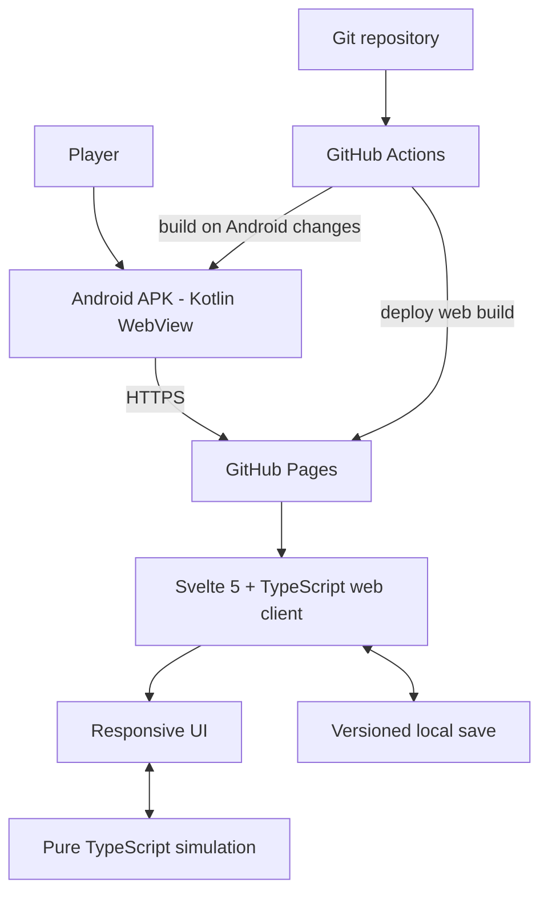

# Technical Architecture

## Education, qualifications, wellbeing and medical state

The pure TypeScript domain modules `education.ts` and `wellbeing.ts` own education and health state transitions. The Education workspace calls domain functions for programme availability, enrollment and weekly academic task planning. Educational Records presents completed academic results and qualifications separately. Enrolling creates `EducationEnrollment` and an `EducationRecord`; attendance and academic progression are automatic weekly responsibilities, not calendar reservations. Programme prerequisites and minimum ability thresholds are checked by the education domain. A completed passing programme records an `AcademicResult` and a `Qualification` with its source `programId`; Work reads those records for eligibility and does not issue or mutate them.

The weekly resolver dispatches education and care actions from `PlannedAction`, applies their costs/effects, resolves academic grades against completed task points, attendance, workload, stress, stamina and health, then updates wellbeing once per week from automatic education/work responsibility load and selected activity effort. Missing academic targets reduces grades. Overload increases stress/fatigue and can trigger burnout/anxiety conditions; rest, mindfulness, counselling and medical check-ups are modeled as planned care actions. Medical conditions, treatment plans and short medication courses are stored in optional `medicalState`.

Education and medical fields exist only when their gameplay state applies. Keep education, healthcare and career rules in their domain modules; keep UI components independent. The weekly plan stores contextual actions only; there are no timetable types, commitments, or time-slot helpers. Do not create a Schedule workspace or manually managed timetable.

**Canonical implementation direction · Reviewed 2026-11-08**

## Delivery architecture
The game is a TypeScript web application hosted on GitHub Pages and opened inside a small native Android WebView shell. Gameplay/UI updates publish through GitHub without reinstalling the APK for every web change.

## Technology decisions
- Web UI: Svelte 5 + TypeScript + Vite.
- Simulation: plain TypeScript domain modules independent of Svelte/browser APIs.
- Tests: Vitest for deterministic simulation and persistence behavior.
- Hosting: GitHub Pages, deployed through GitHub Actions.
- Android: Kotlin Activity + Android WebView; no game logic in the shell.
- Android build: GitHub-hosted runners; no local Android Studio requirement for the normal workflow.
- Initial persistence: versioned local save storage behind a storage adapter; move to IndexedDB only when size/transaction needs justify it.
- WASM: only for a measured CPU-heavy workload with a clear, tested boundary. Keep authoritative game rules in TypeScript until profiling proves a bottleneck.

## Repository layout
- `web/`: Svelte web client, simulation, styles, tests, Vite build.
- `android/`: minimal WebView wrapper.
- `docs/`: canonical product and engineering decisions.
- `.github/workflows/`: lean validation, Pages deployment, Android build.

## Freshness and cache policy
- Wrapper loads the HTTPS GitHub Pages URL.
- Clear WebView disk cache at a fresh app launch, then allow normal HTTP caching during that session. This checks for a fresh deployment without disabling caching for every asset request.
- Do not register a service worker or persistent Cache API shell in the initial implementation.
- Vite production assets use content hashes, so changed files have new URLs.
- The entry HTML is requested afresh on each cold launch; do not restore a previously rendered WebView page after process recreation.
- Provide a refresh/retry path for a user who leaves the app open during a deployment.
- Never treat mutable content or save data as immutable assets.
- Never use HTTP, disable TLS checks, or enable mixed content to work around hosting.
- GitHub Pages does not honor arbitrary server config files such as a presumed `_headers` file; do not rely on one.

## Save persistence and current format
The localStorage adapter uses schema version 6 and three independent device-local save slots. Validate the complete current save envelope, every slot, each character's required calendar and weekly plan, and domain-specific planned-action payloads before exposing or writing data. Unsupported older schemas are not migrated: leave their bytes untouched, show a clear incompatibility notice, and require an explicit player-confirmed reset before a fresh save can be created. Never silently reinterpret an old payload as a current character or overwrite it. Settings such as sound and theme preferences remain separate from game state. No cloud sync or backup is implied.

## Simulation boundaries
Core simulation inputs are game state, action/choice, and random source/seed. Outputs are updated state plus explicit effects/history. No DOM, Svelte, localStorage, network, or Android imports in core simulation. Time advancement is an explicit domain operation. Use integer minor units for money once currency arithmetic expands. Validate invariants at boundaries.

## Game calendar foundation
- Calendar dates are strict ISO date-only strings interpreted in UTC; do not use local Date parsing or wall-clock time in simulation rules.
- Weeks start Monday and span Monday–Sunday. The active date advances in seven-day steps; month/year boundaries are derived from dates, not assumed to align with weeks.
- New characters receive calendar.currentDate and calendar.birthDate values. The weekly model is live: age is derived from these dates and changes on the actual birthday. The current schema requires calendar dates on every character; unsupported older saves must be explicitly reset rather than migrated.
- February 29 birthdays are observed on March 1 in non-leap years. This convention is centralized in the pure calendar module and covered by tests.
- Weekly time advancement, stamina-based activity selection, and deterministic weekly resolution are implemented. Monthly settlement is not yet implemented; current salary, household expenses, tax, interest, market updates, and other annual systems remain on their explicit annual cadence until a separately tested cadence change updates those rules.

## Performance
Keep initial bundle small; avoid unnecessary dependencies. Lazy-load optional heavy features. Profile before optimizing. WASM is not automatically faster: boundary crossings, conversion, build complexity, and mobile constraints must be measured. Test on a real mid-range Android device and throttled mobile connection. Avoid blocking animations and layout shifts.

## Security and privacy
No accounts/backend needed initially. Keep saves on-device unless opt-in sync is later approved. No secrets in the web bundle/repository. WebView loads only the exact HTTPS game host; unrelated links open in the system browser. Disable file/content access and mixed content.

## Native clipboard bridge
The Android WebView exposes a narrowly scoped `AndroidApp.copyToClipboard(text)` JavaScript interface method. It writes a user-requested gameplay debug snapshot through Android's system ClipboardManager and reports success synchronously. Web UI code prefers this native bridge, then uses the secure-context browser Clipboard API, then a focused `execCommand('copy')` fallback for older WebViews. Never report a successful copy unless one of these methods confirms it. Keep the bridge limited to explicit user-initiated copy actions.

## Education, employment, and recurring finances
Education progress, employment records, salary, annual living-cost estimates, performance, experience, and promotions are fields on the simulation's Character model. These fields are optional when the corresponding gameplay state does not apply; any persisted shape change requires a current-schema update and validation tests. Eligibility is centralized in `progression.ts` and checked again by `performActivity`. Annual income/expenses and promotion outcomes are applied in `advanceYear`, then recorded in the character history. Keep country salary balancing explicitly provisional and never use the UI to invent finance state.

Career progression's current staged design and implementation boundary are documented in [CAREER_PROGRESSION.md](CAREER_PROGRESSION.md). Work owns the current-job view, career path preview, role requirements, promotion decisions, bonuses, and career history. A read-only preview must not mutate Character state or the financial ledger; estimated compensation must be labeled separately from actual salary/payroll. Payroll and actual bonuses use the shared Finance transaction path. Do not add new save fields or claim employer/vacancy/bonus state exists until those mechanics are implemented.

## Native Android branding and launch experience
- The original title artwork is the Android launcher/app logo, referenced by the adaptive launcher icon foreground. Keep the source PNG unchanged.
- The title-less life-progression artwork is the centered Android splash image. The AndroidX SplashScreen compatibility API holds it while the hosted game loads, then moves it upward and fades it out when the first page finishes (or a main-frame load error is shown).
- These two artworks are native Android assets only. Do not render either image inside the welcome or character-creation web UI.
- Preserve the splash's black background and avoid adding a second in-page loading/branding hero.

## Household finance model
Household arrangement, savings-goal duration, annual income, paid expenses, and unpaid shortfall are optional Character fields. `getHouseholdBudget` is a pure simulation calculation; `advanceYear` settles the annual budget, applies financial-pressure effects, and records history. No negative balance or debt is generated. The savings target is derived from the selected number of months of estimated costs and current cash; it is not a separate account. The current schema validates these fields when present; incompatible persisted shapes require a deliberate schema update.

## Banking and financial ledger
- `bankAccounts`, cards, loans, investments, properties, businesses, tax balances, and `financialTransactions` are represented in the current Character model when applicable.
- Cash and account balances are distinct integer currency units. `getNetWorth` includes cash, bank accounts, vault cash, prepaid-card balances, property, investments, and business valuations, less active loans, credit-card balances, and unpaid tax liabilities.
- Account operations are pure simulation functions. Each successful operation returns a new Character and records a transaction. Reject overdrafts, invalid values, missing accounts, same-account transfers, and accounts beyond the configured limit.
- The transaction ledger is bounded to the latest 300 records. Annual income, household expense settlement, and savings interest also append ledger entries.
- Current products: checking (0% annual interest) and savings (2% annual interest). Rates are provisional game values.

## Financial products
- Cards, loans, recurring payments, automatic deposits, and personal vault balances are represented only when those products are owned or configured.
- Debit card purchases debit a linked account; credit card purchases increase a liability up to the configured limit; prepaid purchases reduce a funded prepaid asset. Credit-card debt is included in net worth and accrues a simplified annual rate.
- Loan issuance adds cash and an equal liability. Interest and repayments are posted to the common ledger during year settlement. Extra repayments reduce both cash/account holdings and principal liability.
- Recurring payments are annual game-time charges with explicit funding source. Failed cash/account payments do not create debt. Card-funded charges require available credit.
- Auto-deposit rules transfer cash to an account after household costs. Vault operations transfer cash into/out of a separate holding. All these movements must preserve net worth except for actual spending, interest, and loan interest.
- Year settlement is deterministic in order: income and household costs, automatic deposits, recurring payments, loan interest/installments, credit interest/minimum payments. The ledger is capped at 300 entries.

## Property, markets and business assets
- Property, rental-home, investment-holding, market-price, and business state is represented in the current character schema when applicable.
- Mortgage-financed property acquisition issues an equal loan liability and asset value; the down payment is cash outflow. Property sale pays off the linked mortgage before proceeds return to cash.
- Rental income and business operating results are posted to the financial ledger. Property maintenance is included in the annual housing budget. Property appreciation and market movements update asset values during year advancement.
- Market holdings use whole units and current simulated prices for a broad index, technology shares, energy shares, government bonds, and gold. Trading moves cash to/from asset value, records brokerage and realized-gain tax, and government bonds post a 4% annual coupon. Market price updates are deterministic per simulated year to keep saves and tests reproducible while still allowing gains and losses. The current coupon implementation bases the payment on the current bond market price; fixed-coupon accounting against face value remains a known correctness follow-up.
- Business startup moves cash into business valuation; operating profit/loss changes cash, and management consumes an action plus a cash cost.
- Net worth includes all modeled asset classes and subtracts loan and credit-card liabilities.

## Additional bank products
- Checking and savings accounts remain liquid. Fixed deposits store a maturity year and lock withdrawals until that simulated year; their simplified annual rate is 4.5%.
- Prepaid cards store a positive funded balance. Loading transfers value from cash or a bank account; purchases and recurring charges reduce the stored balance. Prepaid balances are assets in net worth, unlike credit card balances which are liabilities.

- Recurring debit-card charges debit the card's linked deposit account; recurring credit-card charges increase the card liability; prepaid-card charges reduce the stored prepaid balance.

## Economic simulation
- `Character.economy` is present when the economic simulation has initialized and stores bounded inflation, growth, benchmark rate, cycle, cost-of-living index, and last update year.
- Annual economic conditions are derived deterministically from simulated year and age. The same input save produces the same rates and market update.
- Inflation updates the cost index, recurring charges, rental agreements, and household budget. Market asset updates are bounded: equities respond primarily to growth, gold responds more to inflation, property growth responds to both, and business operating results respond to growth and performance.
- Economic values are fictional and should be labeled as simplified estimates. Avoid presenting them as real market predictions.

## Tax settlement
- `lastYearTax` and `taxBalance` are modeled as current-schema state when tax settlement applies. Progressive wage tax, positive rental/business income tax, and property levy are assessed annually after asset income and before financial-product autopay.
- Tax settlement draws cash first, then checking/savings balances. Fixed-deposit accounts cannot be used before maturity. Any unpaid amount remains a liability and is deducted from net worth; no negative cash balance is permitted.
- Tax amounts are game-balance assumptions, not jurisdiction-specific tax advice. Ledger entries record paid amounts and remaining liability.

## Creditworthiness
- Credit score is derived from the capped financial ledger, active credit-card utilization, active loan and card debt relative to annual income, and outstanding tax liability. It is deterministic, bounded to 300–850, and does not require a separate persisted score field.
- Loan issuance enforces age 18+, a minimum score of 520, no more than five active loans, annual income, principal limits (3× income for personal/mortgage and 4× for business), total debt no greater than 4× annual income, a score-based minimum interest rate, a 1–30 year term, and a valid non-fixed-deposit repayment account when selected. Rejections are recorded with a specific reason and a 25-point penalty, capped at 100 points. This remains a fictional game metric, not a country-specific bureau report.

## Trading and property transaction costs
- Stock-index and gold trades charge a 0.5% brokerage fee. Buy fees are included in the holding's average cost basis; sell fees reduce proceeds. Positive realized gains incur a simplified 10% capital-gains tax recorded in the ledger.
- Property purchases and sales charge a 1% service/transfer fee. Positive realized property gains incur a simplified 10% capital-gains tax. Sale proceeds must cover linked mortgage debt, fees, and tax or the sale is rejected.
- Fees reduce net worth; transfers between cash and holdings preserve value only before fees. Capital-gains taxes are paid from proceeds and recorded separately.

## Domain module architecture
Keep the simulation domain model independent from Svelte components. Organize UI and simulation capabilities around bounded life-system modules; shared types and persistence are contracts, not a reason to combine screens.

Current Finance UI boundary:
- `FinanceWorkspace.svelte` owns the Finance parent shell and the ordered destinations Banking, Business, Property, Investments, and Taxes.
- `FinanceAccounts.svelte` is the Banking workspace. It owns the internal Accounts, Cards, Loans, and Savings & vault navigation; the expandable credit-score breakdown appears only in Loans. Account ordering is checking, savings, then fixed deposits; card ordering is credit, debit, then prepaid.
- `FinanceProducts.svelte` supplies the focused card, loan, and savings/vault views used inside Banking. Active loans are presented as a compact list; loan applications enforce age, credit-score, income, debt, principal, term, rate-floor, and repayment-account rules. Rejected applications are recorded in the ledger and history and apply a bounded score penalty.
- `FinanceTaxes.svelte` owns tax estimates, annual assessments, and outstanding tax liabilities. Tax is not managed in Banking.
- `FinanceAssets.svelte` owns focused Property, Investments, and Business views, selected independently.
- `FinanceLivingCosts.svelte` is composed by Life → Lifestyle → Home for household arrangement and estimated living costs. Emergency savings targets remain in Banking → Savings & vault.
- App.svelte owns global navigation, character lifecycle, persistence, and time progression. It should not assemble all finance modules inline.

Education and Work are independent top-level destinations with implemented simulation-backed foundations:
- Education owns programme discovery, enrollment, weekly study/assignment/exam actions, automatic attendance/progression, grades, tuition, and qualification history. Education and Educational Records are separate subpages; programme pausing is not exposed as a player action.
- Work owns job discovery, applications, interviews, expiring offers, employment changes, resignation, extra earnings, career development, and promotion offers. Persistent employer operations, broad workplace decisions, benefits, bonuses, and monthly payroll remain planned.
- Do not implement either domain as a status panel inside Finance. Their simulation logic remains callable independently from their UI.

Shared cross-domain effects are communicated through explicit simulation transactions, history events, or narrowly scoped state changes. A bank account may receive salary, but the bank screen does not become a work screen. Keep each domain independently testable and progressively unlockable by age/eligibility.

## Life workspace
The top-level Life destination is a modular UI workspace, not a new simulation subsystem. `LifeWorkspace.svelte` currently exposes Overview, Lifestyle, Family, Family tree, and Life story. Overview composes `HealthWorkspace.svelte`; Family composes `FamilyWorkspace.svelte`; Family tree composes `LifeTreeWorkspace.svelte`; Lifestyle composes `LifestyleWorkspace.svelte`; Life story groups non-activity history and financial records by age/year. Do not document Personal Growth or Personal activities as current Life navigation entries until they are added to the actual workspace. The workspace reuses Character fields and shared history rather than duplicating persisted state. Education, Work, and Finance remain independent top-level destinations. Profile owns character identity, background, appearance, attributes, save-slot management, and settings.

## Banking and Lifestyle ownership

- `FinanceWorkspace.svelte` owns only Finance-level destinations: Banking, Business, Property, Investments, and Taxes, in that order.
- `FinanceAccounts.svelte` is the Banking shell and owns internal Accounts, Cards, Loans, and Savings & vault sections. It composes the existing `FinanceProducts.svelte` views for card, loan, and savings/vault operations.
- `LifeWorkspace.svelte` owns the Lifestyle destination and composes `LifestyleWorkspace.svelte`.
- `LifestyleWorkspace.svelte` provides Supermarket, Subscriptions, and Owned. Supermarket checkout adds food and reusable goods to Owned after successful payment; the player reserves owned food for the weekly plan, and the simulation consumes those portions on week resolution with independent per-stat bonus caps. Subscriptions uses the shared recurring-payment state and provides small service-specific weekly effects. Household arrangement and living-cost state remain backed by the existing household/Finance model and are not exposed as a duplicate Home tab. Emergency savings goals are owned by the Banking savings section in `FinanceProducts.svelte`.
- `makeCashPurchase` and `makeAccountPurchase` debit their selected source and write a financial transaction plus life-history event. Card purchases continue through `makeCardPurchase`, which enforces the card's own available balance or credit limit.
- The current Character schema remains the source of truth for `recurringPayments`, cards, bank accounts, loans, investments, property, business, household, and family fields. Incompatible shape changes require a schema update, not a migration.

## Annual progression and event architecture

The first event-driven slice now lives in the pure TypeScript module `web/src/lib/events.ts`, independent of Svelte/browser APIs. It defines a small authored event set, age/health eligibility, stable deterministic selection, choice affordability/action validation, immediate bounded effects, persistent scheduled consequences, event expiry, and chronological history records. `simulation.ts` prepares an event for a new year, resolves due consequences, expires unanswered events on advancement, and stores a compact recap. The Home UI presents the pending choice and recap.

The simulation now combines deterministic weekly action resolution with separate annual financial/life progression. Keep the core pure TypeScript and independent of Svelte/browser APIs; add monthly settlement only as a separately specified, tested cadence.

Planned boundaries:
- The existing simulation boundary coordinates weekly actions and annual settlement. Do not split it into `week-cycle.ts` or `year-cycle.ts` until concrete module boundaries reduce complexity without duplicating domain rules.
- `events.ts` currently owns the first event definitions, age/health eligibility, deterministic selection, choice validation, immediate effects, delayed consequences, event expiry, and history descriptions. Expand into an `events/` folder only when the catalogue justifies that complexity.
- Domain modules (School, Work, Life/Health, Relationships/Family, Finance, Lifestyle) own their state transitions. The event resolver may invoke domain operations but must not duplicate their business rules.
- The save owns event state, scheduled consequences, and weekly recap/history fields. Validate every persisted field in the current schema. When a persisted shape changes incompatibly, increment the current schema and reject old saves with an explicit reset path; do not build migration adapters.
- Event content is data-driven where useful, but do not build a generic event scripting language or content platform before a small playable set proves the pattern.
- The current event picker is deterministic for the same character identity, age, year, and history length; it does not consume ambient `Math.random()`. Future event systems should use an explicit persisted seed/state if richer randomness is needed.
- Weekly resolution order must be explicit, deterministic, and tested. The live resolver validates the current week's stamina budget, resolves selected actions and automatic background responsibilities with their domain effects/costs, records history/recap, clears successful actions, and advances the date calendar. Monthly and annual settlement remain separate date-boundary operations; do not mix them into the weekly action transaction.
- Return structured effects/recap data from simulation functions so UI can explain meaningful outcomes without re-deriving rules.
- Keep player-facing event content, consequences, and history portable across save/load. Content-version changes must not replay completed events or corrupt pending outcomes.

### Simulation test requirements
- Unit-test event eligibility, costs, outcomes, cooldowns, follow-ups, and invalid choices.
- Test deterministic replay from identical state/seed and save/load continuity with pending consequences.
- Test age/circumstance eligibility in the simulation layer, not only UI.
- Test that financial events preserve ledger and balance-sheet invariants.
- Test that dead characters cannot advance time or perform living-character actions.
- Add multi-year scenario tests that exercise several connected systems; isolated unit tests alone are insufficient evidence of an enjoyable gameplay loop.

The complete design contract and player-facing acceptance criteria are in `docs/GAMEPLAY_LOOP.md`. Distinguish live weekly scheduling/resolution from the remaining planned monthly settlement, date-based event, and later-life systems.

## Weekly calendar and simulation time (implemented foundation)

The live gameplay clock is date-based and weekly, not annual-action-based. The week is the fundamental player turn; months own recurring financial/reporting cadence; years own annual settlement, birthdays, life-stage progression, and long-term reviews.

- Keep calendar/date logic in pure TypeScript domain modules, independent of Svelte, browser APIs, and Android. Use explicit date helpers for week boundaries, month/year boundaries, leap years, birthdays, and age calculation.
- Persist an explicit current game date and the minimum stable identity needed to derive age. Do not increment age once per week or assume every year is exactly 52 weeks.
- The weekly calendar is a date-progression model, not a timetable or 168-hour simulation. Education and employment are automatic background responsibilities; do not invent weekday/period allocations or player-managed schedules.
- Domain screens initiate their own personal activities through add/remove toggles. The simulation validates eligibility and cash affordability, then stores the selected weekly action. Activity stamina is charged exactly once during deterministic weekly resolution; it is not a calendar reservation.
- There is no Schedule workspace. The Advance review is the combined plan/outcome surface; activities are toggled in their owning domains. A failed action must preserve the entire prior Character state.
- Weekly advancement must be a single deterministic domain transaction returning updated state, financial ledger entries, history, event effects, and recap data. Repeated calls/reloads must not duplicate a resolved week.
- Monthly and annual settlement must have explicit date-based due rules and idempotency keys/period markers. Never run annual finance settlement in addition to monthly installments for the same obligation.
- Do not divide existing annual costs/salary/interest by 12 without modeling rounding, due dates, inflation, and payment failures.
- Multi-week advancement must call the same weekly resolver sequentially and stop at any decision boundary. It must not skip weeks with a coarse approximation.
- The current schema is intentionally a clean baseline. Do not add backward migrations. Keep all three current slots, financial ledgers, liabilities/assets, event state, and history internally consistent, and test the current format validator on every schema change.
- The weekly cycle is the live playable time model. Annual mechanics remain only where their own cadence is currently intentional (birthdays, annual payroll/settlement, taxes, market updates, and annual life review); do not reintroduce annual action tokens or duplicate weekly effects through an annual fallback. Monthly settlement is a planned follow-up, not a live feature.

Suggested future module boundaries (do not create empty abstractions prematurely):
- `calendar.ts`: pure calendar/date/birthday helpers.
- `weekly-plan.ts`: owns strict weekly action-plan validation. It must not represent calendar periods or commitments.
- Keep weekly orchestration in the existing simulation boundary until profiling or maintainability evidence justifies extracting a dedicated module.
- Domain modules own their own eligibility, costs, effects, and automatic background progression; the cycle coordinator orchestrates them without duplicating their rules.
- Existing `events.ts` should evolve to support date/deadline-based triggers and follow-ups as a focused follow-up to the current weekly-plan baseline.

## Personal Technology domain

Personal Technology is a modular Life domain. Its canonical behavior, boundaries, and acceptance criteria are specified in [PERSONAL_TECHNOLOGY.md](PERSONAL_TECHNOLOGY.md).

- Model individual device instances with stable IDs, category, fictional model identity, capability tier, condition, acquisition metadata, and ownership/access status.
- Keep domain logic in pure simulation modules; do not put capability checks, condition rules, or ownership mutations in Svelte components.
- Life owns inventory, condition, repair, and replacement. Lifestyle Discover owns the retail catalogue and purchase experience. Finance owns affordability, payment execution, and ledger entries.
- Device purchase/repair/resale must use the existing financial transaction path and be atomic with the corresponding device-state mutation. Failed transactions leave neither a device nor a charge.
- School, Work, and other domains consume capability/access queries through a narrow domain API; they must not mutate device inventory directly or create duplicate sources of truth.
- Separate owned devices from borrowed, shared, school-provided, and work-provided access. Only owned assets belong in personal possessions/net-worth calculations.
- Keep capability tiers category-aware and task-specific. Avoid a universal hardware score and avoid storing derived bonuses.
- Existing saves without device data load as having no personal devices, not invented purchases.
- Keep condition and usage deterministic and auditable. Do not add battery, storage, data, or subscription meters until they support a tested gameplay decision.

## Exploratory architecture direction: portable simulation core

This section records a promising future direction, not an approved implementation requirement or a commitment to a language/toolchain.

- Keep the simulation engine independent of Svelte, browser APIs, Android, and presentation components. The frontend collects player decisions and renders results; domain logic owns rules, validation, state transitions, and consequences.
- Prefer clear domain contracts and modular TypeScript systems first. A stable boundary is more valuable now than choosing a lower-level implementation language prematurely.
- Consider a language-independent simulation interface so selected modules could later be implemented in Rust or another suitable language and exposed to the web client through WebAssembly (WASM).
- WASM is an optional implementation/acceleration path, not the default architecture. Do not rewrite systems in Rust/C++ or introduce WASM solely for perceived performance, fashion, or theoretical efficiency.
- Potential future candidates include computationally expensive world/economy simulation, large-scale NPC decisions, procedural generation, or other workloads shown by profiling to be CPU-bound.
- Keep ordinary UI behavior, navigation, save management, and low-cost domain operations in TypeScript unless evidence supports moving a specific workload.
- Before adopting WASM, benchmark representative game scenarios on target mid-range mobile hardware. Include serialization/data conversion, memory copies, JavaScript/WASM boundary crossings, bundle size, startup cost, debugging, testing, and build/release complexity—not just raw function speed.
- If adopted, move only a bounded, independently testable module at a time. Prefer coarse-grained calls (for example, resolving a week or simulation batch) over many tiny cross-boundary calls.
- Preserve deterministic behavior, seeded randomness, save compatibility, explicit effects/history, and reproducible tests regardless of implementation language.
- Revisit this direction only when the simulation architecture is stable enough and a measured need or concrete portability benefit justifies the additional toolchain.

The near-term implementation remains a pure TypeScript simulation engine with explicit domain boundaries. This exploratory direction must not delay playable gameplay milestones or add development overhead without demonstrated value.

## Family simulation boundary

The Family domain lives in the pure TypeScript module family.ts and is independent of Svelte. It owns persistent family people, directed kinship/guardianship links, player-to-relative bonds, household/dependency references, family-specific history, graph validation, and targeted family interactions. Family state is represented in the current character schema; changes to its persisted shape require updating current-schema validation and tests.

- The player person is a stable graph node, while Character remains authoritative for player identity and stats.
- Family interactions return a new Character and validate eligibility/resources in simulation code. Financial support debits cash and writes a family-support entry to the shared Finance ledger; Family never owns a wallet.
- Relative age is derived from birth year and the current simulation year. Family state does not run a second clock or independently age NPCs.
- New characters receive a generated family-of-origin context; existing saves without family data require an explicit one-time initialization action. No partner or children are invented.
- Historical deaths in generated family background are fixed past facts only. Future family mortality must use the global mortality system.
- Family interactions use stamina and are toggled directly in the Family workspace. They resolve their relationship and ledger effects during weekly advancement without reserving calendar time.
- Keep partnership, parenthood, adoption, care, shared household finances, and inheritance out of the implementation until their full simulation contracts and tests are ready.

Detailed domain rules: [FAMILY_SYSTEM.md](FAMILY_SYSTEM.md).

## UI design system and appearance preferences

The Svelte UI uses a small in-repository design system rather than a third-party component framework.

- Semantic design tokens and theme palettes live in `web/src/styles/`; global layout and legacy domain styling remain in `web/src/app.css` while they are migrated to tokens.
- Reusable presentation primitives live in `web/src/components/` (buttons, panels, section headers, theme option controls). Domain-specific behavior and simulation rules stay in their existing workspaces and pure TypeScript modules.
- Theme preference is an app-level local setting stored in the existing `my-life-simulator.settings` key, not in Character or SaveData. Theme changes do not alter saves or require a save schema migration.
- The default and invalid-preference fallback is `amoled`. Supported themes are `amoled`, `midnight`, `graphite`, and `paper`.
- Updating one preference must preserve all other preferences. Settings writes merge patches into the existing settings object.
- Apply the selected theme to the document root at startup and immediately after selection. Keep gameplay usable if local storage is unavailable.
- Do not add an external UI framework for routine styling. Migrate repeated patterns incrementally and test both dark and light palettes.

The legacy UI color migration is complete: all shared app and workspace CSS color declarations consume semantic tokens from `web/src/styles/tokens.css` and `web/src/styles/themes.css`. Preserve this contract when adding styles; avoid hard-coded palette colors outside intentional artwork or theme-preview swatches.
