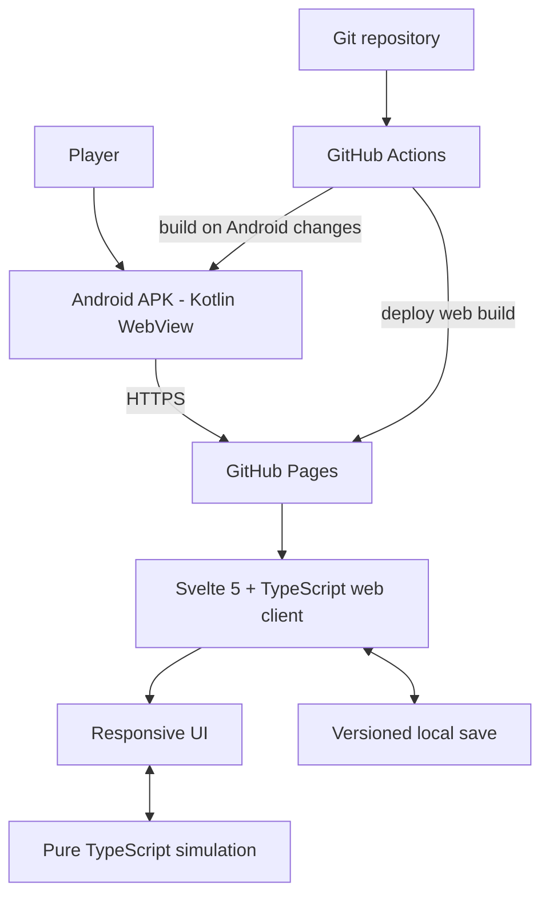

# Technical Architecture

**Canonical implementation direction · Reviewed 2026-11-05**

## Delivery architecture
The game is a TypeScript web application hosted on GitHub Pages and opened inside a small native Android WebView shell. Gameplay/UI updates publish through GitHub without reinstalling the APK for every web change.

## Technology decisions
- Web UI: Svelte 5 + TypeScript + Vite.
- Simulation: plain TypeScript domain modules independent of Svelte/browser APIs.
- Tests: Vitest for deterministic simulation and persistence behavior.
- Hosting: GitHub Pages, deployed through GitHub Actions.
- Android: Kotlin Activity + Android WebView; no game logic in the shell.
- Android build: GitHub-hosted runners; no local Android Studio requirement for the normal workflow.
- Initial persistence: versioned local save storage behind a storage adapter; move to IndexedDB only when size/transaction needs justify it.
- WASM: only for a measured CPU-heavy workload with a clear, tested boundary. Keep authoritative game rules in TypeScript until profiling proves a bottleneck.

## Repository layout
- `web/`: Svelte web client, simulation, styles, tests, Vite build.
- `android/`: minimal WebView wrapper.
- `docs/`: canonical product and engineering decisions.
- `.github/workflows/`: lean validation, Pages deployment, Android build.

## Freshness and cache policy
- Wrapper loads the HTTPS GitHub Pages URL.
- Clear WebView disk cache at a fresh app launch, then allow normal HTTP caching during that session. This checks for a fresh deployment without disabling caching for every asset request.
- Do not register a service worker or persistent Cache API shell in the initial implementation.
- Vite production assets use content hashes, so changed files have new URLs.
- The entry HTML is requested afresh on each cold launch; do not restore a previously rendered WebView page after process recreation.
- Provide a refresh/retry path for a user who leaves the app open during a deployment.
- Never treat mutable content or save data as immutable assets.
- Never use HTTP, disable TLS checks, or enable mixed content to work around hosting.
- GitHub Pages does not honor arbitrary server config files such as a presumed `_headers` file; do not rely on one.

## Save compatibility
Persist an explicit schema version. Validate data before use. Add forward migrations when shape changes. Malformed/unsupported data must not crash the app or silently overwrite an existing save. Keep game state separate from transient UI state. Web deployments must not reset saves without an explicit migration and documented reason.

The current localStorage adapter supports three independent save slots. Schema version 2 stores the active slot ID and each slot's character plus update timestamp. Version 1's single-character save migrates into slot 1 without discarding the character. Settings such as sound preference are stored separately from game state. Saves remain device-local; no cloud sync or backup is implied.

## Simulation boundaries
Core simulation inputs are game state, action/choice, and random source/seed. Outputs are updated state plus explicit effects/history. No DOM, Svelte, localStorage, network, or Android imports in core simulation. Time advancement is an explicit domain operation. Use integer minor units for money once currency arithmetic expands. Validate invariants at boundaries.

## Performance
Keep initial bundle small; avoid unnecessary dependencies. Lazy-load optional heavy features. Profile before optimizing. WASM is not automatically faster: boundary crossings, conversion, build complexity, and mobile constraints must be measured. Test on a real mid-range Android device and throttled mobile connection. Avoid blocking animations and layout shifts.

## Security and privacy
No accounts/backend needed initially. Keep saves on-device unless opt-in sync is later approved. No secrets in the web bundle/repository. WebView loads only the exact HTTPS game host; unrelated links open in the system browser. Disable file/content access and mixed content.

## Native clipboard bridge
The Android WebView exposes a narrowly scoped `AndroidApp.copyToClipboard(text)` JavaScript interface method. It writes a user-requested gameplay debug snapshot through Android's system ClipboardManager and reports success synchronously. Web UI code prefers this native bridge, then uses the secure-context browser Clipboard API, then a focused `execCommand('copy')` fallback for older WebViews. Never report a successful copy unless one of these methods confirms it. Keep the bridge limited to explicit user-initiated copy actions.

## Education, employment, and recurring finances
Education progress, employment records, salary, annual living-cost estimates, performance, experience, and promotions are fields on the simulation's Character model. These new fields are optional to preserve existing save compatibility; no storage schema bump is required. Eligibility is centralized in `progression.ts` and checked again by `performActivity`. Annual income/expenses and promotion outcomes are applied in `advanceYear`, then recorded in the character history. Keep country salary balancing explicitly provisional and never use the UI to invent finance state.

## Native Android branding and launch experience
- The original title artwork is the Android launcher/app logo, referenced by the adaptive launcher icon foreground. Keep the source PNG unchanged.
- The title-less life-progression artwork is the centered Android splash image. The AndroidX SplashScreen compatibility API holds it while the hosted game loads, then moves it upward and fades it out when the first page finishes (or a main-frame load error is shown).
- These two artworks are native Android assets only. Do not render either image inside the welcome or character-creation web UI.
- Preserve the splash's black background and avoid adding a second in-page loading/branding hero.

## Household finance model
Household arrangement, savings-goal duration, annual income, paid expenses, and unpaid shortfall are optional Character fields. `getHouseholdBudget` is a pure simulation calculation; `advanceYear` settles the annual budget, applies financial-pressure effects, and records history. No negative balance or debt is generated. The savings target is derived from the selected number of months of estimated costs and current cash; it is not a separate account. Existing local saves require no schema-version bump.

## Banking and financial ledger
- Optional `bankAccounts` and `financialTransactions` fields extend Character without a schema-version bump; legacy saves remain cash-only until accounts are opened.
- Cash and account balances are distinct integer currency units. `getNetWorth` currently sums cash and bank balances only; expand it when liabilities and other assets are implemented.
- Account operations are pure simulation functions. Each successful operation returns a new Character and records a transaction. Reject overdrafts, invalid values, missing accounts, same-account transfers, and accounts beyond the configured limit.
- The transaction ledger is bounded to the latest 300 records. Annual income, household expense settlement, and savings interest also append ledger entries.
- Current products: checking (0% annual interest) and savings (2% annual interest). Rates are provisional game values.

## Financial products
- Cards, loans, recurring payments, automatic deposits, and personal vault balances are optional Character fields for legacy-save compatibility.
- Debit card purchases debit a linked account; credit card purchases increase a liability up to the configured limit. Credit card debt is included in net worth and accrues a simplified annual rate.
- Loan issuance adds cash and an equal liability. Interest and repayments are posted to the common ledger during year settlement. Extra repayments reduce both cash/account holdings and principal liability.
- Recurring payments are annual game-time charges with explicit funding source. Failed cash/account payments do not create debt. Card-funded charges require available credit.
- Auto-deposit rules transfer cash to an account after household costs. Vault operations transfer cash into/out of a separate holding. All these movements must preserve net worth except for actual spending, interest, and loan interest.
- Year settlement is deterministic in order: income and household costs, automatic deposits, recurring payments, loan interest/installments, credit interest/minimum payments. The ledger is capped at 300 entries.

## Property, markets and business assets
- Optional property, rental-home, investment-holding, market-price, and business arrays preserve compatibility with existing saves.
- Mortgage-financed property acquisition issues an equal loan liability and asset value; the down payment is cash outflow. Property sale pays off the linked mortgage before proceeds return to cash.
- Rental income and business operating results are posted to the financial ledger. Property maintenance is included in the annual housing budget. Property appreciation and market movements update asset values during year advancement.
- Stock-index and gold holdings use whole units and current simulated prices. Trading moves cash to/from asset value. Market price updates are deterministic per simulated year to keep saves and tests reproducible while still allowing gains and losses.
- Business startup moves cash into business valuation; operating profit/loss changes cash, and management consumes an action plus a cash cost.
- Net worth includes all modeled asset classes and subtracts loan and credit-card liabilities.

## Additional bank products
- Checking and savings accounts remain liquid. Fixed deposits store a maturity year and lock withdrawals until that simulated year; their simplified annual rate is 4.5%.
- Prepaid cards store a positive funded balance. Loading transfers value from cash or a bank account; purchases and recurring charges reduce the stored balance. Prepaid balances are assets in net worth, unlike credit card balances which are liabilities.

- Recurring debit-card charges debit the card's linked deposit account; recurring credit-card charges increase the card liability; prepaid-card charges reduce the stored prepaid balance.
